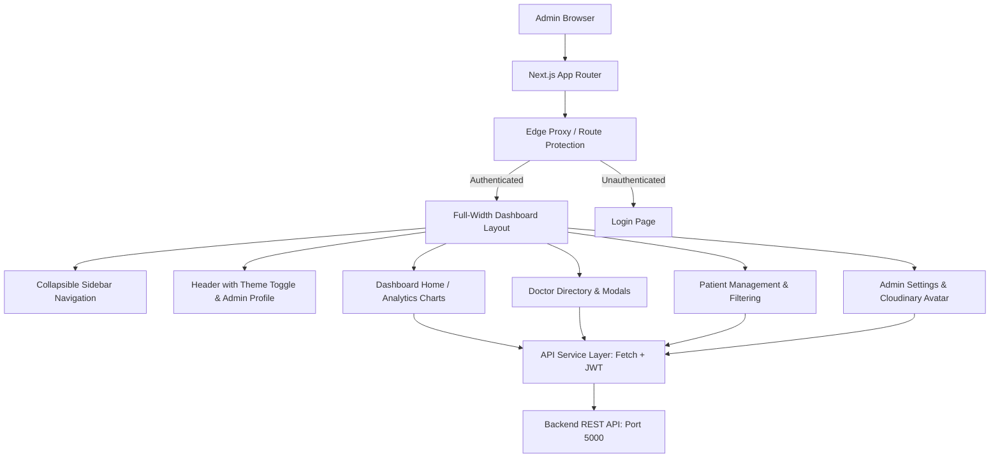

# Doctor Tracker — Frontend Web Application

## Description
Doctor Tracker is a modern, responsive administrative web application for healthcare operators to manage medical specialists, track admitted patients, and visualize real-time hospital analytics. Built with Next.js (App Router), TypeScript, Tailwind CSS v4, Framer Motion, and Sonner, the frontend features secure JWT route protection, rich interactive charts, custom theme-driven toast notifications, and full dark/light mode compatibility without static hardcoded colors.

---

## Setup Guide

### Prerequisites
- Node.js (v18 or higher)
- pnpm (or npm / yarn)
- Running Doctor Tracker Backend API (`http://localhost:5000/api`)

### Step-by-Step Installation

1. **Clone the repository and enter directory:**
   ```bash
   git clone <frontend-repo-url>
   cd doctorTraker-Frontend
   ```

2. **Install dependencies:**
   ```bash
   pnpm install
   ```

3. **Configure Environment Variables:**
   Create `.env.local` or copy from `.env.example`:
   ```bash
   cp .env.example .env.local
   ```

   **`.env.example` Reference:**
   ```env
   NEXT_PUBLIC_API_URL=http://localhost:5000/api
   ```

4. **Build and Run:**
   - **Development mode:**
     ```bash
     pnpm run dev
     ```
   - **Production build & start:**
     ```bash
     pnpm run build
     pnpm start
     ```
   - Application runs on: `http://localhost:3000`

5. **Demo Admin Credentials:**
   - **Email:** `admin@doctortracker.com`
   - **Password:** `Admin@DT2026`
   *(A 1-click "Fill Demo Admin" button is available on `/login` for evaluation convenience)*

---

## System Architecture



### Key Application Routes
- **`/login`**: Animated authentication portal with secure cookie storage and 1-click credentials filler.
- **`/dashboard`**: Real-time KPI summary, 14-day date-based activity timeline chart, doctor workload meters, and condition breakdown.
- **`/doctors`**: Directory table with multi-field search, specialization & hospital filters, date range filters, pagination, doctor creation/editing, and assigned patient management.
- **`/doctors/workload`**: Dedicated clinical workload capacity analytics page.
- **`/patients`**: Dedicated patient management page with search, condition, doctor, gender, and date-wise filtering, modal registration, and deletion.
- **`/patients/conditions`**: Dedicated patient diagnostic breakdown page.
- **`/profile`**: Administrator settings, credential overview, and Cloudinary avatar photo uploader.

---

## Technical Decisions

### 1. Zero Static Hex Colors via Tailwind CSS v4 Theme CSS Custom Properties
Rather than hardcoding static hex codes (`#14b8a6`, `#3b82f6`) inside JSX utility classes, the entire design system is powered by CSS variables mapped through Tailwind CSS v4 (`@theme inline` in `globals.css`). Tokens like `--background`, `--card`, `--primary`, `--secondary`, `--accent`, and `--border` dynamically adjust between dark and light modes with seamless contrast ratios, ensuring compliance with accessibility guidelines and brand adaptability.

### 2. Hydration-Safe State Synchronization with `useSyncExternalStore`
To avoid React 19 hydration mismatches and flickering when reading client-side data (`localStorage` themes, authentication snapshots in browser cookies), state is subscribed through React's native `useSyncExternalStore` API instead of synchronous `useEffect` set-state triggers. This prevents layout shifts and guarantees server-rendered HTML matches initial client hydration smoothly.

---

## Visual Evidence

### Desktop Views
- **Dashboard Home with 14-Day Activity Timeline & KPI Cards:**
  
- **Doctor Directory with Filter Toolbar & Assigned Patients:**
  
- **Patient Management Table with Multi-Criteria Filters:**
  

### Mobile Views
- **Responsive Collapsible Sidebar & Mobile Dashboard:**
  

---

## Evaluation Credentials
- **Admin Email:** `admin@doctortracker.com`
- **Admin Password:** `Admin@DT2026`
