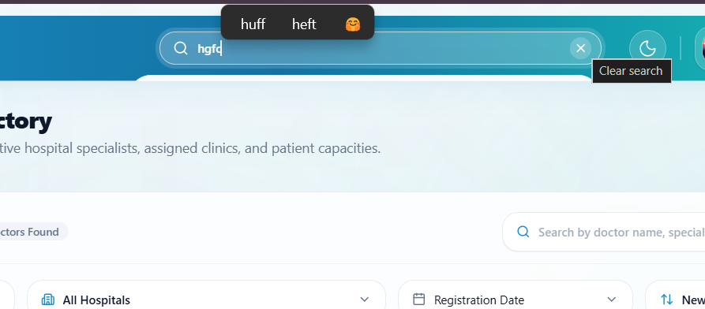
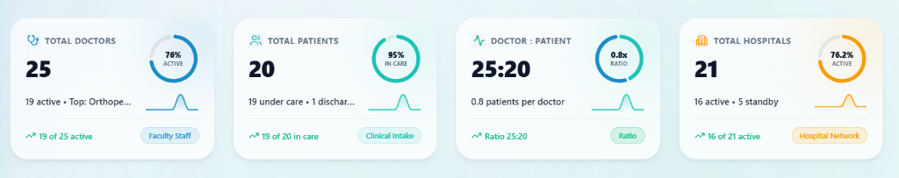
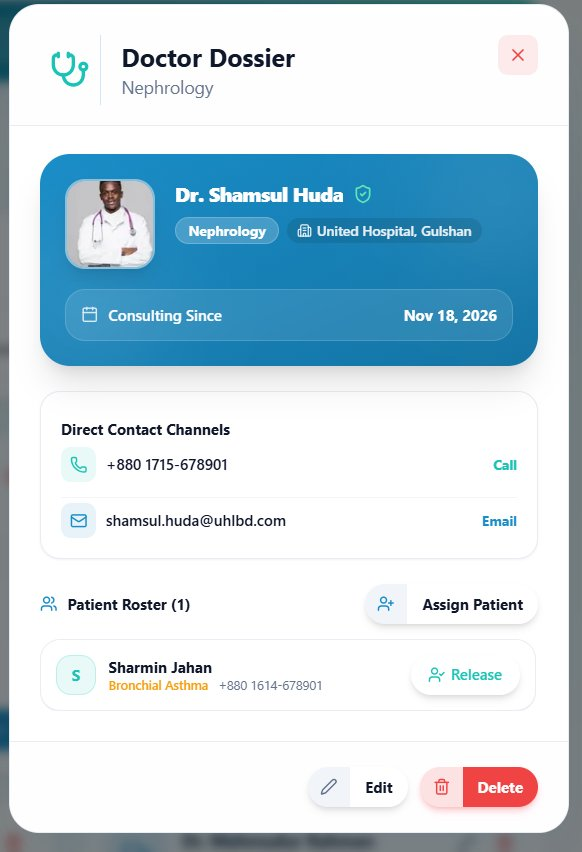
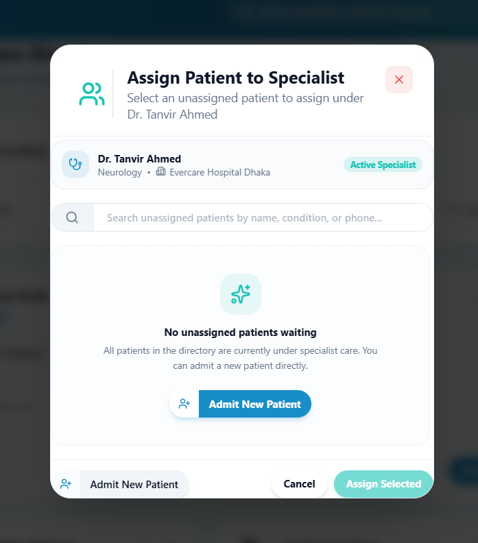
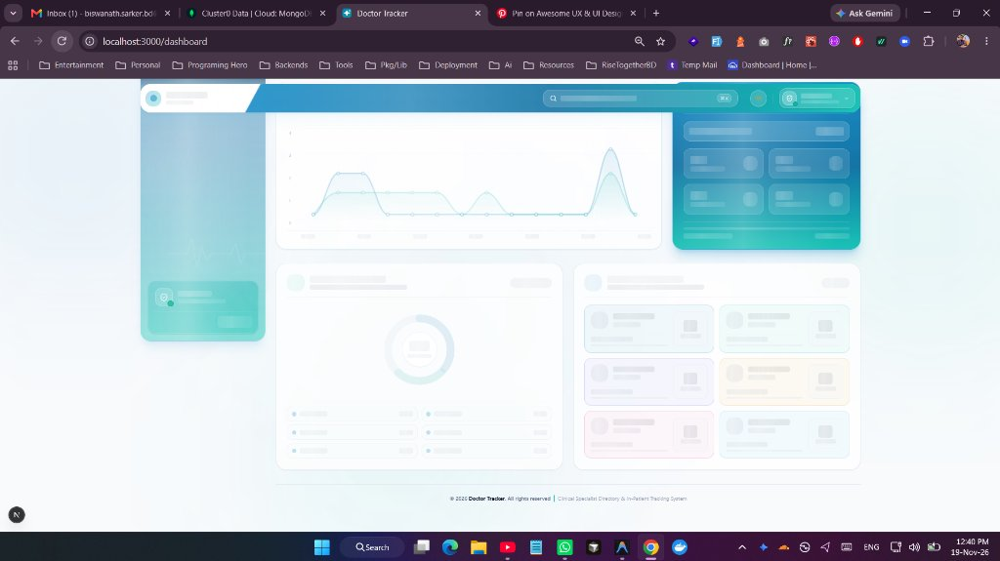

# Doctor Tracker — Frontend Web Application

## Description
Doctor Tracker is an intuitive, enterprise-grade healthcare management web application designed for hospital administrators to coordinate specialist doctors, monitor patient admissions and releases, and visualize real-time clinical workload analytics. Crafted with Next.js 14 App Router, TypeScript, Tailwind CSS v4, Framer Motion, and Recharts, the application delivers instant search and multi-criteria filtering, smooth drawer dossiers, responsive mobile navigation, and strict React Server Component (RSC) performance optimizations with zero static hardcoded colors.

---

## Setup Guide

### Prerequisites
- **Node.js**: v18.0.0 or higher
- **Package Manager**: `pnpm` (recommended), `npm`, or `yarn`
- **Backend API**: Running Doctor Tracker Backend server (`http://localhost:5000/api`)

### Step-by-Step Installation

1. **Clone the repository and navigate to frontend directory:**
   ```bash
   git clone <repository-url>
   cd doctorTraker-Frontend
   ```

2. **Install dependencies:**
   ```bash
   pnpm install
   ```

3. **Configure Environment Variables:**
   Copy `.env.example` to create your local `.env`:
   ```bash
   cp .env.example .env
   ```

   **`.env.example` Reference:**
   ```env
   # backend rest api base url (development)
   NEXT_PUBLIC_API_URL=http://localhost:5000/api

   # backend rest api base url (production fallback example)
   # NEXT_PUBLIC_API_URL=https://your-production-backend.com/api
   ```

4. **Build and Run:**
   - **Development mode:**
     ```bash
     pnpm run dev
     ```
   - **Production build and start:**
     ```bash
     pnpm run build
     pnpm start
     ```
   - Open your browser at: `http://localhost:3000`

5. **Demo Administrative Credentials:**
   - **Email:** `admin@doctortracker.com`
   - **Password:** `Admin@DT2026`
   *(A 1-click "Fill Demo Admin" shortcut is available on the `/login` screen for rapid evaluation)*

---

## System Architecture

```mermaid
flowchart TD
    Browser[Admin Browser] --> Router[Next.js App Router]
    
    Router --> AuthGuard[Edge Route Protection & AuthProvider]
    AuthGuard -->|Authenticated| Shell[Dashboard Layout Shell]
    AuthGuard -->|Unauthenticated| LoginPortal[/login Screen]

    Shell --> TopNav[Dashboard Header & Global Search]
    Shell --> SideNav[Collapsible Sidebar / Mobile Nav]
    Shell --> Drawers[Global Slide-Over Dossiers]

    Shell --> PageDash[/dashboard Analytics Page]
    Shell --> PageDocs[/doctors Specialist Directory]
    Shell --> PagePts[/patients Patient Directory]
    Shell --> PageProf[/profile Admin Settings]

    PageDash --> Recharts[Recharts Interactive Timeline & Donut]
    PageDocs --> DocRoster[Doctor Cards, Filter Stations & Pagination]
    PagePts --> PtRoster[Patient Cards, Unassigned Status Tabs & Modals]

    PageDash & PageDocs & PagePts & PageProf --> ClientServices[API Service Layer: Fetch + JWT Cookie]
    ClientServices --> ExpressBackend[(Backend REST API : Port 5000)]
```

### High-Level Data Flow & Service Interactions
- **Route Protection & Session State (`AuthProvider.tsx`)**: Synchronizes authentication snapshots via HTTP-only cookies and `/api/auth/me`. Automatically redirects unauthenticated traffic to `/login` without UI flash.
- **Service Layer (`/server/*.service.ts`)**: Centralized HTTP client utilities handling token injection, payload serialization, and structured error responses.
- **Global Search Station (`NavbarGlobalSearch.tsx`)**: Debounced real-time cross-search communicating with `/api/search` to display instant doctor dossiers and patient details.
- **State Management & Live Sync (`useDoctorActions`, `usePatientActions`)**: Executes optimistic UI updates and targeted roster refetches without full-page reloads when doctors or patients are admitted, assigned, or released.

---

## Technical Decisions

### 1. Strict React Server Component (RSC) Boundaries for Zero-JS Skeleton Streaming
- **Context & Problem:** In complex dashboard applications, marking presentational wrappers or skeletons with `'use client'` forces the Next.js bundler to ship large JavaScript chunks to the browser, inflating initial bundle size and delaying First Contentful Paint (FCP).
- **Solution & Impact:** We performed a strict architectural audit across the component tree, stripping `'use client'` from all 12 page skeletons (`DashboardPageSkeleton`, `DoctorsPageSkeleton`, `PatientCardSkeleton`, etc.), data display cards (`TodaysReportCard`, `CloudInfrastructureCard`), and UI primitives (`Input.tsx`). These components now stream as pure, zero-runtime HTML directly from the server. Client components are reserved strictly for interactive state machines, event listeners, and Recharts canvases.

### 2. Client-Side Timeframe Slicing over Redundant API Refetching
- **Context & Problem:** In analytics dashboards, toggling between timeline ranges (7 Days, 14 Days, 30 Days) often triggers separate network requests, introducing loading spinners, network latency, and layout flickering for the user.
- **Solution & Impact:** When loading the dashboard, the service fetches a consolidated 30-day window once. Switching between 7D, 14D, and 30D toggles performs instant in-memory calendar slicing and zero-gap date padding directly on the client side. This achieves sub-millisecond chart re-renders with zero network roundtrips and zero UI layout shifts.

---

## Visual Evidence

### Desktop Views

#### 1. Interactive Analytics Dashboard (KPIs, 14-Day Timeline & Specialization Distribution)


#### 2. Specialist Doctor Directory (Multi-Criteria Filters, Search & Capacity Meters)


#### 3. Doctor Dossier Slide-Over Drawer (Patient Roster, Contact Channels & Admit / Assign Controls)


#### 4. Patient Assignment Station (Unassigned Patient Selection Modal)


---

### Mobile Views

#### 5. Mobile Responsive View (Collapsible Drawer, Touch Controls & Compact Data Grid)


---

## Evaluation Credentials
- **Admin Email:** `admin@doctortracker.com`
- **Admin Password:** `Admin@DT2026`
